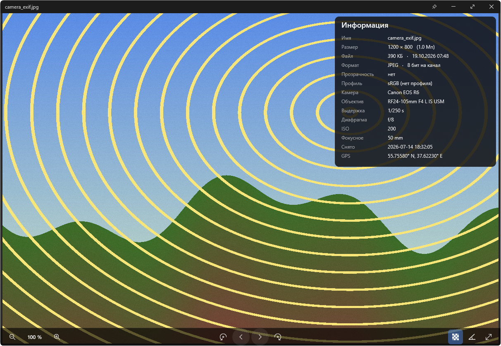
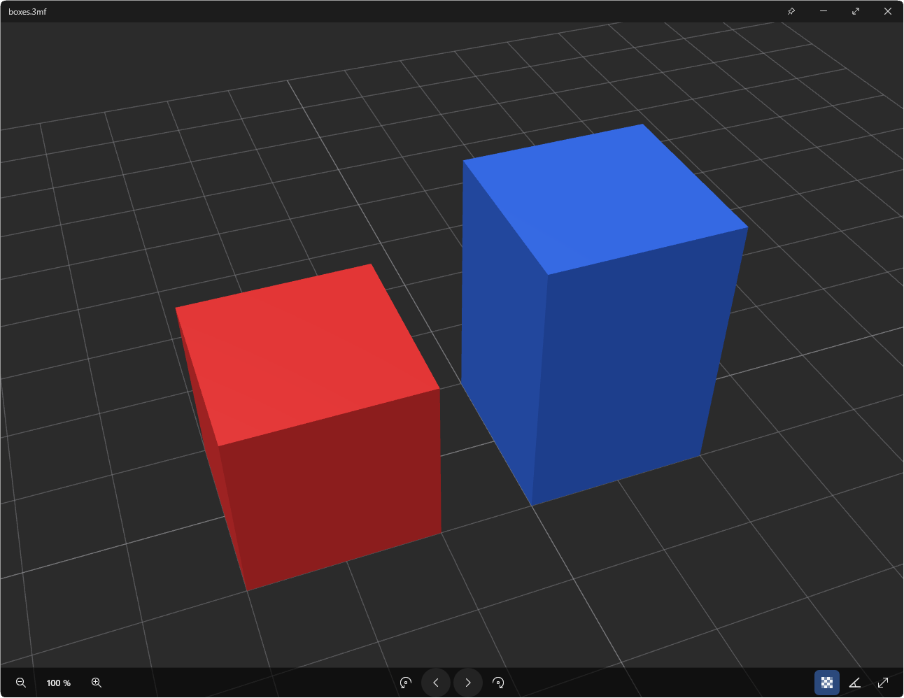
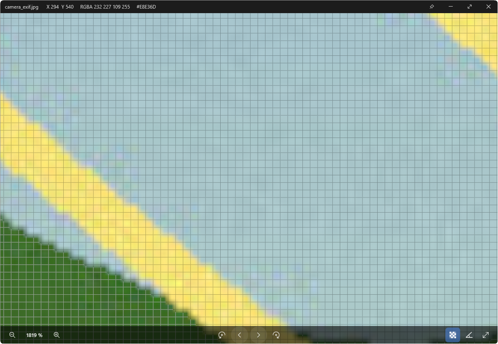

# Lightbox

**Русский** · [English](README.en.md)

Быстрый просмотрщик изображений и 3D-моделей для Windows 10/11 — в духе Picasa Photo Viewer: фото открывается мгновенно поверх затемнённого рабочего стола, листается стрелками и закрывается по Esc. Интерфейс на русском или английском — по языку Windows, переключается в «Настройки → Интерфейс».



## Возможности

- **Мгновенное открытие.** Сначала показывается встроенная миниатюра или уменьшенная копия, полное разрешение догружается в фоне. Соседние фото декодируются заранее, поэтому листание без задержек.
- **Два режима, как в Picasa.** Во весь экран поверх затемнённого рабочего стола или в окне по размеру фото. Клик по свободному месту переключает режим, Esc закрывает.
- **Масштаб от 1 % до 50 000 %** к курсору, без дрожания на огромном увеличении. Начиная с 800 % — сетка пикселей, а в заголовке — координаты и цвет пикселя под курсором.
- **Поворот сохраняется в файл без потерь.** JPEG — без перекодирования, как jpegtran; PNG и APNG, GIF (все кадры), BMP, QOI, TGA и WebP без потерь — пересохраняются с прежней битностью (у PNG сохраняются и все метаданные, включая промпты ComfyUI); TIFF получает тег ориентации. Ctrl+Z откатывает сохранение. WebP с потерями, AVIF и HEIC поворачиваются только при просмотре.
- **Редактирование:** обрезка (X) с пропорциями (у JPEG без потерь), экспозиция, контраст, насыщенность и теплота (A), выпрямление на любой угол с автообрезкой. Всё откатывается по Ctrl+Z.
- **Цвет.** ICC-профили (Adobe RGB, Display P3, CMYK) переводятся в sRGB, HDR и EXR отображаются с тонмаппингом.
- **Огромные изображения** (30 000 × 20 000 и больше) — тайлами.
- **SVG — вектор при любом масштабе:** видимая часть перерисовывается в разрешении экрана.
- **Анимация** GIF, WebP и APNG: пауза — пробел, покадровый шаг — `,` и `.`.
- **Документы по пробелу:** PDF и тексты — в самом Lightbox, DOCX, XLSX и другие — через обработчики предпросмотра Windows.
- **3D-модели** STL, OBJ (+MTL) и 3MF с цветами, включая проекты Bambu Studio, OrcaSlicer и PrusaSlicer: цвета филаментов и столы (↑/↓). Мышь вращает, колесо приближает. Модели листаются вместе с фото и видны в ленте миниатюр.
- **Инструменты для моделей:** линейка между двумя точками (D), каркас (W), разрез по высоте (P, ↑/↓ двигают), «положить гранью на стол» (B).
- **G-code** (.gcode, .gcode.3mf): траектория по типам линий, слои ↑/↓, время печати и расход филамента.
- **Инспектор:** гистограмма, отдельные каналы R/G/B/A, панель информации (EXIF, камера, GPS с картой, ICC). Для PNG из ComfyUI и A1111 показываются промпт и параметры генерации с кнопками копирования.
- **Рейтинг и метки** (Ctrl+1…5, Ctrl+K) записываются средствами Windows — их видят Проводник и Lightroom; фильтр по рейтингу.
- **Пакетное переименование и конвертация** выбранных фото (Ctrl+B).
- **Сравнение двух фото** рядом с синхронным масштабом, по очереди в одном месте или картой разности.
- **Слайд-шоу, лента миниатюр, отслеживание папки, drag & drop** в окно и из окна.
- **Работа с файлами:** удаление в корзину, копирование изображения или пути, быстрые папки F1–F9, «Открыть в редакторе», «Показать в проводнике».
- **Просмотр по пробелу в Проводнике** (как Quick Look в macOS) и окно, закреплённое поверх остальных.
- **Любую клавишу можно переназначить** в «Настройки → Клавиши».

| 3D-модели | Сетка пикселей и цвет под курсором |
|---|---|
|  |  |

## Форматы

| | |
|---|---|
| Фото | JPEG, PNG, APNG, GIF, WebP, BMP, ICO, TIFF, TGA, QOI, AVIF, HEIC/HEIF¹, JPEG XR |
| Графика | SVG/SVGZ, PSD (композит), DDS, PBM/PGM/PPM/PAM |
| HDR | Radiance HDR, OpenEXR |
| RAW | DNG, CR2, CR3, NEF, ARW, ORF, RW2, RAF, PEF, SRW и другие (встроенное превью) |
| 3D | STL (ASCII и двоичный), OBJ + MTL, 3MF (и проекты слайсеров), G-code |
| Документы | PDF, TXT и код; остальное — через обработчики предпросмотра Windows |

¹ HEIC открывается через кодек Windows («Расширения для изображений HEIF» из Microsoft Store).

## Установка

**[Скачать установщик](https://github.com/Nicoskin/LightBox/releases/latest/download/lightbox-setup.exe)** (`lightbox-setup.exe`, последняя версия) и запустите. Все версии — на странице [Releases](https://github.com/Nicoskin/LightBox/releases).

- Устанавливается только для текущего пользователя, права администратора не нужны.
- При установке можно сразу сделать Lightbox программой по умолчанию для всех форматов. Windows покажет страницу «Приложения по умолчанию», где выбор подтверждается одним нажатием.
- Установщик не подписан, поэтому SmartScreen может предупредить о неизвестном издателе: «Подробнее» → «Выполнить в любом случае».
- Удаляется через «Параметры → Приложения → Установленные приложения».

**Портативная версия:** [lightbox-portable.zip](https://github.com/Nicoskin/LightBox/releases/latest/download/lightbox-portable.zip). Распакуйте куда угодно, например на флешку. Настройки и кэш лежат в папке `data` рядом с `lightbox.exe`. Трей, автозапуск и записи в реестре не используются, поэтому пробел в Проводнике и ассоциации файлов есть только в установленной версии.

**Обновления.** Lightbox сам проверяет новые версии раз в день; это можно выключить в «Настройки → Система». Новая версия скачивается с GitHub, её SHA-256 сверяется, и она ставится поверх без потери настроек.

## Управление

| Клавиши | Действие |
|---|---|
| ← → / PgUp PgDn / колесо¹ | предыдущее / следующее фото |
| Home / End | первое / последнее |
| колесо, + / − | масштаб к курсору |
| 0 / 1 / Z | вписать / 100 % / переключить |
| Enter / F11 / клик по фону | во весь экран / окно |
| R / L | повернуть по / против часовой (сохраняется в файл) |
| M / Shift+M | отразить по горизонтали / вертикали |
| [ / ] | наклон на 1° для просмотра (Shift — 0,1°) |
| X / A | обрезка / коррекция |
| Ctrl+S / Ctrl+Shift+S / Ctrl+Z | сохранить / сохранить как / отменить сохранение |
| Ctrl+C / Ctrl+Shift+C | копировать изображение / путь |
| Ctrl+1…5 / Ctrl+0 / Ctrl+F | рейтинг / снять рейтинг / фильтр по рейтингу |
| Ctrl+K / Ctrl+B | метки / пакетная обработка |
| Delete | в корзину |
| E | открыть в редакторе |
| F1–F4, F6–F9 | быстрые папки |
| I / H / G | информация / гистограмма / сетка пикселей |
| Shift+1…4 / Shift+0 | каналы R, G, B, A / все каналы |
| T / N / F | фон прозрачности / сглаживание / лента миниатюр |
| C / V / удерживать пробел | сравнение / рядом или в одном месте / показать A |
| S или F5 | слайд-шоу |
| пробел / , . | пауза анимации / кадр назад, вперёд |
| Esc | закрыть |

¹ Колесо по умолчанию меняет масштаб; листание колесом включается в настройках.

**3D-модели:** перетаскивание вращает, Shift или Ctrl + перетаскивание сдвигает, колесо приближает, 0 или двойной клик возвращает исходный вид. D — линейка, W — каркас, P — разрез, B — положить гранью; ↑/↓ переключают столы, слои G-code или двигают разрез.

## Трей и пробел в Проводнике

В «Настройки → Система» можно оставить Lightbox в трее после закрытия и запускать его вместе с Windows. Тогда фото открываются ещё быстрее, и начинает работать **просмотр по пробелу**: выделите файл в Проводнике и нажмите пробел — откроется окно по размеру фото. Повторный пробел или Esc закрывает его, кнопка 📌 оставляет фото в отдельном окне поверх остальных.

Настройки хранятся в `%APPDATA%\Lightbox\settings.toml`.

## Сборка из исходников

Нужны Rust (stable, `x86_64-pc-windows-msvc`), Visual Studio Build Tools с Windows SDK, CMake и NASM (для SIMD в libjpeg-turbo).

```powershell
cargo build --release                            # target\release\lightbox.exe
cargo run --release --example gen_testdata       # тестовые изображения в testdata\
cargo test --release
pwsh tools/release.ps1 -Repo Nicoskin/LightBox   # установщик и портативный zip в dist\
```

Шейдеры компилируются `fxc.exe` из Windows SDK при сборке; без SDK берутся готовые из `shaders/compiled`.

Командная строка: `lightbox <файл>`, без аргументов — стартовый экран; `--register` / `--unregister` — «Открыть с помощью» (HKCU); `--background` — запуск в трее; `--bench <файл>` — время каждой стадии открытия.

## Лицензия

[MIT](LICENSE)
